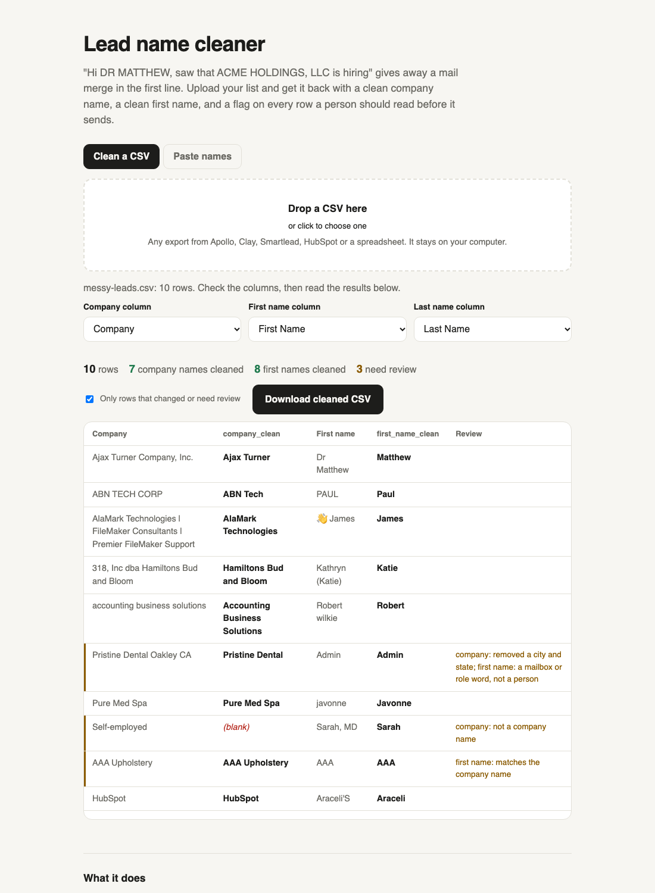

# Lead name cleaner

"Hi DR MATTHEW, saw that ACME HOLDINGS, LLC is hiring" gives away a mail merge in the first line. Upload a lead CSV and get it back with three columns added: `company_clean`, `first_name_clean`, and `needs_review` with the reason.

**Use it in the browser:** https://trav54219.github.io/lead-name-cleaner/ (your file never leaves your computer)



## What it fixes

| Input | company_clean |
|---|---|
| `Ajax Turner Company, Inc.` | `Ajax Turner` |
| `ABN TECH CORP` | `ABN Tech` |
| `AlaMark Technologies \| FileMaker Consultants \| Premier FileMaker Support` | `AlaMark Technologies` |
| `318, Inc dba Hamiltons Bud and Bloom` | `Hamiltons Bud and Bloom` |
| `Pristine Dental Oakley CA` | `Pristine Dental` (flagged) |
| `accounting business solutions` | `Accounting Business Solutions` |
| `Pure Med Spa`, `Valley AG`, `HubSpot`, `IBM` | unchanged |
| `Self-employed`, `N/A`, `Confidential` | blank, flagged |

| Input | first_name_clean |
|---|---|
| `Dr Matthew`, `Sarah, MD` | `Matthew`, `Sarah` |
| `PAUL`, `javonne` | `Paul`, `Javonne` |
| `👋 James`, `Araceli'S` | `James`, `Araceli` |
| `Kathryn (Katie)`, `Robert "Bob"` | `Katie`, `Bob` |
| `Robert wilkie` (last name Wilkie) | `Robert` |
| `Dr Sean Li We Are Actively Hiring At Antai Global` | `Sean` |
| `DeAndrea`, `O'Brien`, `Juan Carlos`, `A.J.` | unchanged |
| `Admin`, `O.`, `AAA` at AAA Upholstery, `Дарья` | flagged for review |

A blank is never filled with "there" or "your team". A row with no usable name usually isn't a real person, and a generic greeting just sends a worse email to a worse address. Filter on `needs_review = no` before you upload to your sequencer.

## How I tested it

The unit tests cover every example above (`node --test`). Then I ran it on three real lead lists of mine, 798 rows in total: med spas and dental practices, battery makers, and aviation shops. I read every value it changed. That turned up six mistakes the tests hadn't caught, and each one is fixed with a test added:

- "Med Spa" was losing "Spa", because SpA is an Italian legal suffix.
- "Body Sculpt LA" lost "Sculpt LA", because LA was read as Louisiana.
- "CIDV" was turned into "Cidv".
- "A.J." was turned into "A.j".
- "Pravinbhai K." kept the trailing initial.
- "Julie" at "Julie Collins Chiropractic" was flagged as a company name, when owner-named businesses are normal.

It's deterministic: no AI, no API, no cost, and the same input always gives the same output. It won't fix a name that's simply wrong in your CRM, and it won't expand an acronym.

## Command line

Needs Node 18 or newer. No dependencies.

```
npx github:Trav54219/lead-name-cleaner leads.csv > leads-cleaned.csv
npx github:Trav54219/lead-name-cleaner leads.csv --company "Account Name" --first "First" > out.csv
```

Or import it: `import { cleanCompany, cleanFirstName } from "./clean.js"`.

Built by [Travis Heurtelou](https://trav54219.github.io/gtm-engineering-portfolio/). Also: [Domain health](https://trav54219.github.io/domain-health/). MIT license.
